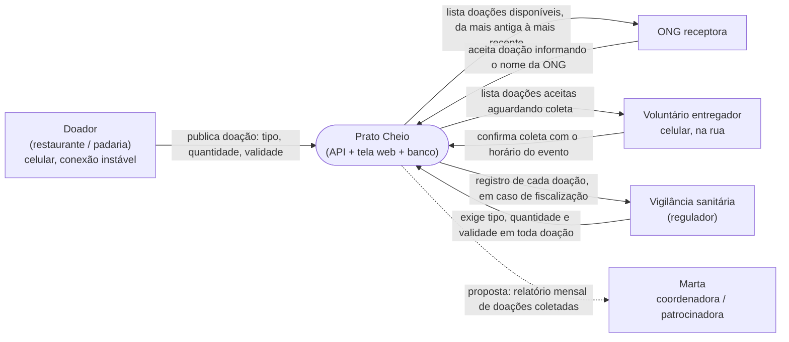

# Diagrama de contexto — Prato Cheio

**Pergunta:** quem troca informação com o Prato Cheio, o que cada um entrega e recebe, e onde termina o sistema?

**Decisão que sustenta:** D2 e a decisão de análise A (fatia mínima, sem autenticação) — nenhum ator faz login; o sistema confia no nome que a ONG declara no aceite.

**Situação:** retrato da `main` no commit `cb16555`. Só a seta tracejada (relatório para a Marta) é proposta: o relatório mensal ainda não existe.

**Elementos:** 6 (limite: 9). **Fora da fronteira:** o canal de aviso à ONG (história #8, canal ainda não escolhido) e a planilha do experimento da hipótese, preenchida à mão.
