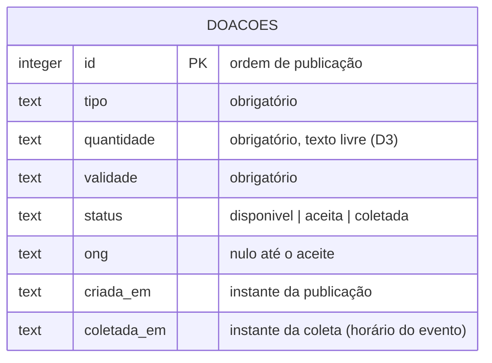

# Diagrama de dados — Prato Cheio

**Pergunta que este diagrama responde:** o que o banco guarda de cada doação, e o que muda
nele quando o banco sair de SQLite para PostgreSQL (ADR 0001)?

## Hoje (SQLite) × alvo da Unidade 3 (PostgreSQL)

| Coluna | Hoje — `src/db.js` (SQLite) | Alvo — PostgreSQL 16 (ADR 0001) |
|---|---|---|
| `id` | `INTEGER PRIMARY KEY AUTOINCREMENT` | `INTEGER GENERATED ALWAYS AS IDENTITY PRIMARY KEY` |
| `tipo`, `quantidade`, `validade` | `TEXT NOT NULL` | `TEXT NOT NULL` (sem mudança) |
| `status` | `TEXT NOT NULL DEFAULT 'disponivel'` | igual |
| `ong` | `TEXT` | igual |
| `criada_em` | `TEXT NOT NULL DEFAULT (datetime('now'))` | `TIMESTAMPTZ NOT NULL DEFAULT now()` |
| `coletada_em` | `TEXT` (nulo até a coleta; ISO 8601 enviado pelo celular) | `TIMESTAMPTZ` |

## Divergências declaradas

- **O código ainda não foi migrado.** O `src/db.js` continua em `node:sqlite`; a tabela
  "Alvo" é o que o ADR 0001 decide, não o que roda hoje.
- **`criada_em` muda de formato.** Em SQLite é texto `AAAA-MM-DD HH:MM:SS` (UTC); em
  PostgreSQL vira `TIMESTAMPTZ` e chega na API como ISO 8601. Nenhum teste atual confere
  esse formato, e a planilha do experimento da hipótese (`docs/analise.md` →
  `## Hipótese e experimento`) lê esse campo. Por isso a conversão precisa ser conferida à
  mão na migração.
- **Falta um dado que o backlog pede:** o horário do aceite (experimento da hipótese) ainda
  não tem coluna e segue anotado na planilha. O da coleta já tem: `coletada_em`, da
  história "voluntário marca a doação como coletada".

## Revisão — 08/10/2026 (ADR 0002)

O ADR 0002 substituiu o ADR 0001 só em **onde** o PostgreSQL roda (instalado em cada
notebook em vez de contêiner; o CI continua com contêiner). O schema-alvo acima não muda:
continua PostgreSQL 16, com as mesmas colunas e tipos. As divergências com `src/db.js`
continuam as listadas acima.
