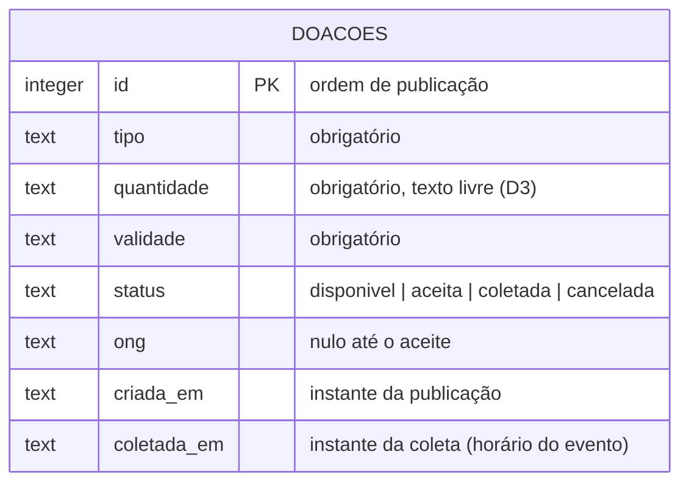

# Diagrama de dados — Prato Cheio

**Pergunta:** o que o banco guarda de cada doação, e o que muda nele quando o banco sair de SQLite para PostgreSQL?

**Decisão que sustenta:** ADR 0001/0002 (migração na Unidade 3, contida em `src/db.js`) e D3 (`quantidade` em texto livre).

**Situação:** retrato da `main` no commit `cb16555` (diagrama e coluna "Hoje"); a coluna "Alvo" é proposta do ADR 0001.

## Hoje (SQLite) × alvo da Unidade 3 (PostgreSQL)

| Coluna | Hoje — `src/db.js` (SQLite) | Alvo — PostgreSQL 16 (ADR 0001) |
|---|---|---|
| `id` | `INTEGER PRIMARY KEY AUTOINCREMENT` | `INTEGER GENERATED ALWAYS AS IDENTITY PRIMARY KEY` |
| `tipo`, `quantidade`, `validade` | `TEXT NOT NULL` | `TEXT NOT NULL` (sem mudança) |
| `status` | `TEXT NOT NULL DEFAULT 'disponivel'` | igual |
| `ong` | `TEXT` | igual |
| `criada_em` | `TEXT NOT NULL DEFAULT (datetime('now'))` | `TIMESTAMPTZ NOT NULL DEFAULT now()` |
| `coletada_em` | `TEXT` (nulo até a coleta; ISO 8601 enviado pelo celular) | `TIMESTAMPTZ` |

## Divergências entre este diagrama e o `src/db.js`

1. **`status`:** o diagrama admite só quatro valores (`disponivel`, `aceita`, `coletada`,
   `cancelada`); o `CREATE TABLE` do `src/db.js` aceita qualquer texto (não há `CHECK`).
   Quem garante os valores é o código de `src/repositorio.js`, não o banco.
2. **`ong`:** o diagrama diz "nulo até o aceite", ou seja, preenchido em toda doação aceita
   (decisão D2); no `src/db.js` a coluna aceita nulo em qualquer status. A regra vive só em
   `src/doacoes.js`.
3. **Datas:** o diagrama trata `validade`, `criada_em` e `coletada_em` como instantes; o
   `src/db.js` guarda as três como `TEXT`, e em formatos diferentes: `criada_em` sai do
   SQLite como `AAAA-MM-DD HH:MM:SS`, `coletada_em` chega do celular em ISO 8601. Nada no
   banco confere ou normaliza esses valores — na migração para `TIMESTAMPTZ` a conversão
   precisa ser conferida à mão.

**Notas (não são divergências do diagrama):** o código ainda não foi migrado — a coluna
"Alvo" é decisão, não o que roda; e o horário do aceite (experimento da hipótese) ainda não
tem coluna e segue anotado na planilha.

## Revisão — 08/10/2026 (ADR 0002)

O ADR 0002 substituiu o ADR 0001 só em **onde** o PostgreSQL roda (instalado em cada
notebook em vez de contêiner; o CI continua com contêiner). O schema-alvo acima não muda:
continua PostgreSQL 16, com as mesmas colunas e tipos. As divergências com o `src/db.js`
estão listadas acima.

## Revisão — 22/10/2026

O diagrama foi conferido na branch `entrega-2` contra o schema atual de `src/db.js`
e as decisões registradas em `docs/projeto.md`.
